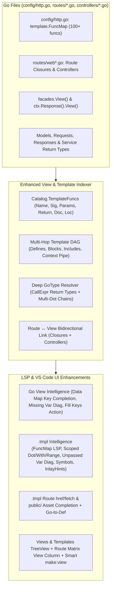

# Analysis of Enhancements for `facades.View` & `.tmpl` Files in `goravel-vscode-extension`

This document analyzes the current state of `facades.View` (`contracts/view.View`), `ctx.Response().View()` (`contracts/http.ResponseView`), and `.tmpl` / `.gohtml` template support in `goravel-vscode-extension` (`v0.7.0`), cross-referenced against real-world usage patterns in `basegoravel`.

---

## 1. Current Baseline Capabilities (`v0.7.0` / P5)

| Area | Currently Implemented (`goravel-vscode-extension`) | Key Implementation Files |
|---|---|---|
| **Language & Grammar** | `goravel-tmpl` language registration (`.tmpl`, `.gohtml`), TextMate grammar (`text.html.goravel-tmpl`), bracket/comment auto-closing, and basic `gdefine`/`gtemplate`/`gblock`/`gif`/`grange`/`gwith`/`gcsrf` snippets | `package.json`, `language-configuration.tmpl.json`, `syntaxes/goravel-tmpl.tmLanguage.json`, `snippets/goravel-tmpl.code-snippets` |
| **Catalog Indexing** | Scans `resources/views/` and `LoadViewsFrom(...)` (`packages/*/views`); parses single `{{ define }}`, `{{ template }}` / `{{ block }}` includes, `.var` references, `View().Make`, `View().First`, `View().Exists`, `View().Share`, and `path.View` | `server/internal/indexer/schema.go`, `server/internal/indexer/extras.go` |
| **Go File Intelligence** | View name completion, hover, go-to-definition (active + package fallback), missing template diagnostics, unused data map key hint, and Quick Fix to create a missing `.tmpl` file | `server/internal/framework/views.go` (`ViewCompletions`, `ViewHover`, `ViewLocations`, `ViewDiagnostics`, `ViewCodeActions`) |
| **`.tmpl` File LSP** | Completion for `{{ template "..." }}`, `.vars`, 1-level `.model.Field`, `$locals`, and 19 Go built-in functions; hover & definition; cross-file rename/references; unclosed `{{` / unbalanced `{{ end }}` diagnostics; top-of-file CodeLens | `server/internal/framework/views.go`, `server/internal/lsp/server.go`, `server/internal/lsp/references.go`, `server/internal/lsp/rename.go` |

---

## 2. Real-World Gaps Discovered in `basegoravel` vs. `goravel-vscode-extension`

Inspecting `basegoravel` alongside `goravel-vscode-extension` exposes **12 concrete gaps and high-value enhancement opportunities**:

### Gap 1: Custom `template.FuncMap` Functions in `config/http.go` Are Invisible to `.tmpl` LSP & Grammar
- **Evidence in `basegoravel`:** `config/http.go:41-1770` registers **100+ custom template helper functions** via `gin.NewTemplate(gin.RenderOptions{ FuncMap: template.FuncMap{ ... } })` — including `substr`, `upper`, `lower`, `title`, `trim`, `truncate`, `now`, `formatDate`, `dateFormat`, `timeAgo`, `add`, `sub`, `mul`, `div`, `safeHTML`, `safeJS`, `default`, `isEmpty`, `isNotEmpty`, `formatNumber`, `formatCurrency`, `formatBytes`, `seq`, `merge`, `deepMerge`, etc.
- **Current Limitation:** `server/internal/framework/views.go:745-769` hardcodes only the 19 standard library `text/template` built-ins (`tmplBuiltins`). Custom `FuncMap` functions get **no autocomplete, no hover signature, no go-to-definition, no pipe (`|`) argument validation, and no unknown-function diagnostics**.

### Gap 2: Route Closures (`facades.Route().Get("/path", func(ctx) ...)`) Lose Route Linkage
- **Evidence in `basegoravel`:**
  - `routes/web_pusat/web.go:10-36` renders `auth/signin.tmpl`, `auth/signup.tmpl`, `auth/dashboard.tmpl`, and `auth/map.tmpl` inside anonymous `func(ctx http.Context) http.Response` closures passed to `facades.Route().Get(...)`.
  - `routes/web.go:55-59` renders `welcome.tmpl` inside `facades.Route().Get("/", func(ctx http.Context) http.Response { ... })`.
- **Current Limitation:** In `server/internal/indexer/extras.go:88-112`, `indexViews` only resolves `routeForCtrl` when `fd.Recv != nil` (controller struct methods). For route closures inside `func Web()`, `ctrlLabel` becomes `"Web"` and `routeForCtrl` is `""` (empty), so `.tmpl` CodeLens and Hover fail to display `GET /signin`, `GET /dashboard`, `GET /map`, or `GET /`.

### Gap 3: No Go-Side Completion or Diagnostics for Required Template Variables inside `View().Make` Data Maps
- **Evidence in `basegoravel`:** When writing `ctx.Response().View().Make("auth/signin.tmpl", map[string]any{ "|" })` in `routes/web_pusat/web.go:11`, the template (via `layouts/header.tmpl:101-102`) requires `supabase_url` and `supabase_key`.
- **Current Limitation:**
  - `ViewCompletions` (`server/internal/framework/views.go:181-242`) only completes template names and `ShareKey` — it provides **zero completion** when the cursor is inside the `map[string]any{...}` keys.
  - `checkUnusedViewDataMap` (`views.go:487-532`) warns on *extra* unused keys passed from Go, but **never warns when a required `.var` used by the template is missing from the Go map literal**.

### Gap 4: Undefined / Mismatched `.var` References in `.tmpl` Files Are Not Flagged
- **Evidence in `basegoravel`:**
  - `resources/views/chat/index.tmpl:3-7` includes `{{template "layouts/header.tmpl" .}}` (which expects `.supabase_url` and `.supabase_key`), and then on lines 6–7 references `{{.supabaseUrl}}` and `{{.supabaseAnonKey}}` (camelCase vs. snake_case mismatch!).
  - `resources/views/meetings/room.tmpl:145,206` references `{{.meetingId}}` and `{{.livekitUrl}}`.
- **Current Limitation:** `TemplateDiagnostics` (`views.go:1196-1326`) checks `{{ ... }}` balance and `{{ template }}` existence, but **does not diagnose `.var` references that are never passed by any caller or `View().Share`**, nor does it offer fuzzy "Did you mean `.supabase_url`?" or "Add key to caller `View().Make`" Quick Fixes.

### Gap 5: Orphaned Views, Empty `.tmpl` Files, & Unwired Web Routes Go Undetected
- **Evidence in `basegoravel`:**
  - `resources/views/layouts/auth.tmpl` is a **0-byte empty file**.
  - `resources/views/chat/index.tmpl`, `resources/views/meetings/index.tmpl`, and `resources/views/meetings/room.tmpl` exist in `resources/views/`, while `routes/web_chat_app/web.go` and `routes/web_meeting_app/web.go` have empty `func Web() {}` bodies (`0 callers`).
  - Conversely, `app/http/controllers/me_controller.go:75,81` calls `View().Make("errors/500.tmpl", ...)` and `View().Make("me/profile.tmpl", ...)`, neither of which exists in `resources/views/`.
- **Current Limitation:**
  - Empty `.tmpl` files receive no diagnostic or Quick Fix to scaffold `{{ define "..." }}`.
  - Orphaned page templates (`0 callers` and `0 parent includes`) have no indicator in CodeLens or Sidebar and no Quick Fix to wire a route in `routes/web_*.go`.
  - When `ViewCodeActions` scaffolds a missing template from `me_controller.go:81` (`me/profile.tmpl`), it generates a bare `<div>` instead of offering layout inclusion (`layouts/header.tmpl` + `layouts/scripts.tmpl`) and nested struct fields.

### Gap 6: Shallow Type Inference for Controller Variables Passed to `View().Make`
- **Evidence in `basegoravel`:** In `app/http/controllers/me_controller.go:45,69,81-85`:
  ```go
  authUser, err := controller.getAuthenticatedUser(ctx)
  profile, err := controller.userService.GetCurrentUserProfile(ctx, userUuid)
  return ctx.Response().View().Make("me/profile.tmpl", map[string]any{
      "title":   "My Profile",
      "user":    authUser,
      "profile": profile,
  })
  ```
- **Current Limitation:**
  - `inferExprModelType` (`server/internal/indexer/extras.go:434-454`) only handles `*ast.Ident`, `*ast.UnaryExpr`, and `*ast.CompositeLit` — it returns `""` for method/function calls (`*ast.CallExpr`) like `controller.getAuthenticatedUser(ctx)` (`*auth.User`) and `controller.userService.GetCurrentUserProfile(...)` (`*responses.UserProfileResponse` / `*models.User`).
  - `Catalog.Structs` only indexes structs in `app/models` and `app/http/requests`, ignoring `app/http/responses`, `app/services`, and `pkg/`.
  - Nested field completion/hover in `.tmpl` (`nestedFieldPrefixRe` in `views.go:677`) only resolves **1 dot level** (`.user.Field`), failing on multi-level chains like `{{ .profile.User.Email }}` or `{{ .user.Role.Name }}`.

### Gap 7: Single-Pass Template Hierarchy & Unscoped `with` / `range` / Partial Context Pipelines
- **Current Limitation in `server/internal/indexer/extras.go:489-539` & `views.go`:**
  1. `propagateTemplateHierarchy` runs a **single pass** over `c.ViewItems` (unordered Go map). Multi-hop chains (`page.tmpl` → `layout.tmpl` → `header.tmpl` → `meta.tmpl`) miss transitive variable propagation depending on map iteration order.
  2. In `parseTemplateMetadata` (`extras.go:291`), `if argStr == "." || argStr == "$" || strings.HasPrefix(argStr, ".")` treats `{{ template "card.tmpl" .user }}` as passing the full root context `.` instead of rebinding `.` in `card.tmpl` to the type of `.user`.
  3. Inside `{{ with .profile }} ... {{ end }}` or `{{ range .users }} ... {{ end }}` (without `$item :=`), `.` (dot) changes scope to the element/field type of `.profile` or `.users`, whereas `$.` always refers to the root context. Currently, `.` and `$.` are treated identically everywhere in the file.
  4. `localVarDeclRe` (`views.go:678`) extracts `$var :=` globally up to `off` without checking whether the `{{ range }}` / `{{ with }}` / `{{ if }}` block defining `$var` has already closed via `{{ end }}`.
  5. Multiple `{{ define "..." }}` blocks in a single `.tmpl` file: `parseTemplateMetadata` (`extras.go:279`: `if vi.DefineName == ""`) only records the **first** `{{ define }}` in a file, ignoring helper sub-templates defined in the same file.

### Gap 8: Non-Literal Data Arguments & Complete `facades.View()` Contract Coverage
- **Current Limitation:**
  - `findViewCalls` (`views.go:31-152`) only inspects inline `map[string]any{...}` or a local `ident := map[string]any{...}` composite literal. It misses:
    - Map mutations: `data := map[string]any{}; data["key"] = val`
    - `gin.H{...}` or struct/model instances passed directly as `data` (`View().Make("profile.tmpl", profile)`)
    - Helper functions wrapping `ctx.Response().View().Make(...)`
  - `facades.View().GetShared()` and `facades.View().RegisteredViews()` from `contracts/view.View` have no hover or code intelligence.

### Gap 9: No HTML Route Link (`href`, `action`, `fetch`) or Static Asset (`public/`) Intelligence in `.tmpl`
- **Evidence in `basegoravel`:**
  - `resources/views/chat/index.tmpl:179-182` references `<script src="/js/e2ee/crypto.js">`, `<script src="/js/e2ee/signal.js">`, etc.
  - `resources/views/auth/map.tmpl:17,20` and `meetings/room.tmpl:153,181,329` reference `<a href="/dashboard">`, `<a href="/map">`, `window.location.href = '/meetings'`, and `fetch('/api/meetings/${MEETING_ID}/token')`.
- **Current Limitation:** Inside `.tmpl` files, `goravel-lsp` does not offer completion, hover, go-to-definition, or broken-link diagnostics for registered Goravel routes (`Catalog.Routes`) or static files under `public/`.

### Gap 10: Missing Editor Structural Features for `.tmpl` (`DocumentSymbol`, `InlayHint`, `SignatureHelp`, Grammar Injections)
- **Current Limitation:**
  - **No `textDocument/documentSymbol`:** VS Code Outline and Breadcrumbs are empty for `.tmpl` files.
  - **No `textDocument/inlayHint` for `.tmpl` or `View()`:** `s.inlayHint` (`server.go:1122`) exits immediately if `!strings.HasSuffix(uri, ".go")`.
  - **TextMate Grammar (`syntaxes/goravel-tmpl.tmLanguage.json`):**
    - `package.json:391` maps `"meta.embedded.block.goravel-tmpl": "go"`, which can cause VS Code's Go grammar/extension to misparse Go template syntax (since `{{ define "x" }}` and `.field` are not valid standalone Go statements).
    - `{{ .var }}` inside `<script>` (`meetings/room.tmpl:145,206`, `layouts/header.tmpl:101-102`), `<style>`, and double/single-quoted HTML attributes (`chat/index.tmpl:6-7`) needs explicit injection rules into `source.js`, `source.css`, and `string.quoted.*.html`.
    - Alpine.js directives (`x-data`, `x-show`, `x-for`, `x-model`, `x-text`, `@click`, `:class`) used across `basegoravel/resources/views/**/*.tmpl` lack dedicated highlighting and snippets.

### Gap 11: No Sidebar TreeView or Route Matrix Integration for Views & Templates
- **Current Limitation:**
  - `s.overview()` (`server/internal/lsp/server.go:1206-1234`) does **not** return `views` or `sharedViewVars`.
  - The Goravel Activity Bar (`package.json:77-94`) has `Models & Schema`, `Routes`, `Migrations`, and `Commands, Seeders & Schedules`, but **no `Views & Templates` explorer**.
  - The **Routes Explorer** and **Route Matrix Webview** (`client/src/extension.ts:449-538`) do not show which `.tmpl` view a route renders or let users jump to the template.

### Gap 12: `goravel.artisan.makeView` Context-Awareness & Interactive Scaffolding
- **Current Limitation:**
  - In `client/src/commands/artisan.ts:149-151`, right-clicking a subfolder like `resources/views/auth` in the VS Code Explorer runs `goravel.artisan.makeView` without receiving the clicked `uri: vscode.Uri`, so it doesn't pre-fill `auth/`.
  - It does not offer an option to wrap the new view with existing project layouts (e.g. `layouts/header.tmpl` + `layouts/scripts.tmpl` or `layouts/dashboard_header.tmpl`).

---

## 3. Proposed Architecture & Enhancement Roadmap (Phase 6: `P6.1` – `P6.12`)



---

### P6.1: Custom `template.FuncMap` Indexing & Full LSP Support
- **Indexer (`server/internal/indexer/extras.go`, `schema.go`):**
  - Add `TemplateFuncItem` to `Catalog`:
    ```go
    type TemplateFuncItem struct {
        Name       string   `json:"name"`
        Signature  string   `json:"signature"`  // e.g. "func(str string, start, length int) string"
        Params     []string `json:"params"`     // e.g. ["str string", "start int", "length int"]
        ReturnType string   `json:"returnType"` // e.g. "string"
        Doc        string   `json:"doc,omitempty"`
        Builtin    bool     `json:"builtin"`
        Loc        Location `json:"loc"`
    }
    ```
  - Parse `template.FuncMap{ "name": ... }` composite literals and `.Funcs(...)` calls across `config/` (such as `config/http.go`), `app/`, and `bootstrap/`.
  - Extract inline `func(...)` parameter names/types, return types, selector references (e.g. `strings.ToUpper`), and leading comments.
- **LSP (`server/internal/framework/views.go`, `server/internal/lsp/server.go`):**
  - **Completion:** Suggest all `Catalog.TemplateFuncs` at action start `{{ | }}`, after sub-expressions `{{ (| }}`, and especially after pipe operators `{{ .name | | }}` (filtering/prioritizing functions that accept at least 1 argument).
  - **Hover & Go-to-Definition:** Hovering over `formatCurrency` or `timeAgo` in `.tmpl` displays its full signature and doc comment; `F12` jumps directly to `config/http.go:465`.
  - **Signature Help (`textDocument/signatureHelp`) & Argument Arity Diagnostics:** Validate argument count in `{{ funcName arg1 arg2 }}` and `{{ val | funcName arg1 }}` (accounting for the piped value as the final argument), and warn on unknown template function names.

### P6.2: Route Closure & Group Prefix Resolution for View Callers
- **Indexer (`server/internal/indexer/extras.go`, `routes.go`):**
  - When indexing `View().Make` / `View().First` inside `routes/**/*.go`, match the enclosing `*ast.FuncLit` (closure) against indexed `Catalog.Routes` by file and byte/line span (or by walking route group chains in `routes.go`).
  - Record `ViewCaller.Route = "GET /signin"` and `ViewCaller.Controller = "routes/web_pusat.Web (GET /signin)"`.
  - Also attach `View string` to `indexer.RouteItem` whenever a route closure or controller action renders a view, enabling bidirectional Route ↔ View navigation.

### P6.3: Go Data Map Key Completion, Missing Required Variable Diagnostics & "Fill View Keys" Code Action
- **Go Completion (`ViewCompletions` in `server/internal/framework/views.go`):**
  - Detect when cursor `goOff` is inside a key position of `View().Make("view.tmpl", map[string]any{ "|" })` or `View().First(...)`.
  - Suggest all `UsedVars` from `"view.tmpl"` (and its transitively included templates) not yet present in the map literal, showing in `Detail` which template/partial references `.var` (e.g. `Required by layouts/header.tmpl (line 101)`).
- **Go Diagnostics (`ViewDiagnostics`):**
  - Warn (or Hint) when `View().Make("view.tmpl", data)` omits a `.var` referenced unconditionally by `"view.tmpl"` (and not provided by `facades.View().Share(...)`).
- **Go Code Action (`ViewCodeActions`):**
  - Offer `"Fill missing template variables for '<view>'"` to insert all missing `UsedVars` keys into `map[string]any{...}` with sensible default placeholders (e.g. `facades.Config().GetString("supabase.url")` if another caller already passes that expression for the same key!).

### P6.4: `.tmpl` Unpassed Variable Diagnostics & Fuzzy Rename / Add-to-Controller Quick Fixes
- **Template Diagnostics (`TemplateDiagnostics` in `server/internal/framework/views.go`):**
  - When a template has at least one known caller (`len(vi.Callers) > 0`), check each referenced `.var` against `resolveViewVarsForTemplate(path, cat)` (which includes direct vars, inherited parent vars, and `SharedViewVars`).
  - If `.var` is not passed by any caller:
    - Compute Levenshtein / normalized snake_case vs. camelCase similarity against passed variables (e.g., `.supabaseUrl` vs. `.supabase_url`).
    - Emit a Warning/Hint: `"Template variable '.supabaseUrl' is not passed by any caller of 'chat/index.tmpl' (did you mean '.supabase_url'?)"`.
- **Template Quick Fixes (`TemplateCodeActions`):**
  1. `"Change '.supabaseUrl' to '.supabase_url'"` (if a close match exists in scope).
  2. `"Add 'supabaseUrl' to View().Make(...) in <Controller/Route>"` (cross-file edit inserting `"supabaseUrl": nil,` into the caller's data map).
  3. `"Register 'supabaseUrl' globally via facades.View().Share(...)"`.

### P6.5: Deep Type Inference (Service/Helper Call Return Types & Multi-Level `.a.b.c` Chains)
- **Indexer (`server/internal/indexer/models.go`, `extras.go`):**
  - Expand `Catalog.Structs` to index structs across `app/models`, `app/http/requests`, `app/http/responses`, `app/services`, and `pkg/`.
  - Index function and method return types (`Catalog.FuncReturns`: `RecvType.MethodName` / `FuncName` → primary non-error return type).
  - Enhance `inferExprModelType` (`extras.go:434`) to resolve:
    - Method & function calls (`controller.userService.GetCurrentUserProfile(...)` → `*responses.UserProfileResponse`, `controller.getAuthenticatedUser(ctx)` → `*auth.User`, `facades.Config().GetString(...)` → `string`).
    - Slice types (`[]models.Meeting`, `[]*models.User`) so `{{ range $i, $m := .meetings }}` infers `$m` (and `.` inside the range body) as `models.Meeting`.
    - Selector expressions (`req.User` → field type on `req`).
- **Multi-Level Chain Resolution (`views.go`):**
  - Replace single-dot `nestedFieldPrefixRe` and `nestedFieldAtOffset` with a multi-segment chain resolver (`resolveChainGoType(["profile", "User", "Company"], vars, locals, cat)`) supporting arbitrary depth `{{ .profile.User.Company.Name }}` and `{{ $item.User.Email }}`.

### P6.6: Multi-Hop Template DAG, Multiple `{{ define }}` Blocks & Context Scope (`with` / `range` / Partial Args)
- **Fixed-Point DAG Propagation (`propagateTemplateHierarchy` in `extras.go`):**
  - Replace the single map pass with a fixed-point loop (up to depth 8) so multi-level includes (`page.tmpl` → `layout.tmpl` → `header.tmpl` → `meta.tmpl`) propagate `UsedVars` upward and `ViewVars` downward deterministically.
  - Support multiple `{{ define "name" }}` blocks within a single `.tmpl` file (`Defines []TemplateDefine` on `ViewItem`).
  - Record the exact pipeline expression passed to `{{ template "sub" <expr> }}` (`Include.ContextExpr`):
    - If `<expr>` is `.` or `$`, inherit parent root `ViewVars`.
    - If `<expr>` is `.profile` or `$item`, bind the child template's root `.` type to the inferred `GoType` of `.profile` / `$item`!
- **Block-Scoped `.` vs. `$.` and Lexical `$var` Scope in `.tmpl` (`views.go`):**
  - Track the active block stack (`range`, `with`, `if`, `define`, `block`) enclosing cursor offset `off`:
    - Inside `{{ with .profile }}` or `{{ range .users }}`, `.Field` resolves against the `with`/`range` subject type, while `$. topVar` always resolves against the root template `ViewVars`!
    - Scope local variables (`$idx, $item :=`) strictly to their enclosing `range`/`with`/`if` block before its matching `{{ end }}`.

### P6.7: Orphaned View & Empty Template Detection + Route Wiring Quick Fix
- **Diagnostics & CodeLens (`views.go`):**
  - **Empty `.tmpl` file** (e.g., `resources/views/layouts/auth.tmpl`): Emit a Hint/Warning `"Empty template file"` with a Quick Fix `"Scaffold {{ define \"layouts/auth.tmpl\" }} block"`.
  - **Orphaned View** (e.g., `chat/index.tmpl`, `meetings/index.tmpl`, `meetings/room.tmpl` — top-level templates not in `layouts/`/`partials/` with `0 callers` and `0 parent includes`):
    - Show a CodeLens at the top of the `.tmpl` file: `$(warning) Unreferenced view (0 routes/controllers) — Click to scaffold route`.
    - Offer a Quick Fix / Code Action to scaffold a `facades.Route().Get("/chat", ...)` handler in the matching `routes/web_*.go` (or `routes/web.go`) pre-populated with the template's `UsedVars`!

### P6.8: Non-Literal Data Map Tracking & `GetShared()` / `RegisteredViews()` Intelligence
- **Map Variable Mutation & Struct Context (`extras.go`, `views.go`):**
  - Track `data["key"] = val` assignments on local map variables passed to `View().Make(name, data)`.
  - Support struct instances passed directly as `View().Make("profile.tmpl", profile)` by exposing exported struct fields of `profile` as top-level `.Field` variables in `"profile.tmpl"`.
  - Add Hover on `facades.View().GetShared()` listing all indexed `SharedViewVars` and on `facades.View().RegisteredViews()` listing all registered `PackageViewDirs`.

### P6.9: HTML Route URL (`href`, `action`, `fetch`) & Static Asset (`public/`) Intelligence in `.tmpl`
- **Route & Asset Completion / Hover / Definition / Diagnostics in `.tmpl` (`views.go`):**
  - Inside `href="/|"` , `action="/|"`, `fetch('/|')`, `axios.get('/|')`, and `window.location.href = '/|'`:
    - Suggest all registered HTTP routes from `Catalog.Routes` (`GET /dashboard`, `GET /map`, `POST /api/meetings/{id}/token`), showing controller/handler and middleware in Hover, and jumping to the route registration on `F12`!
  - Inside `<script src="/|">`, `<link href="/|">`, and ``:
    - Suggest static files from `public/` (and `resources/`), resolve go-to-definition to the asset file on disk, and emit a Warning if a local asset path does not exist in `public/`.

### P6.10: `.tmpl` Document Symbols (Outline/Breadcrumbs), Inlay Hints & Enhanced TextMate Grammar
- **Document Symbols (`textDocument/documentSymbol` in `server.go`, `views.go`):**
  - Register `"documentSymbolProvider": true` in `server.go`.
  - For `.tmpl` files, return a hierarchical symbol tree of `{{ define "..." }}`, `{{ block "..." }}`, `{{ template "..." }}`, `{{ range ... }}`, `{{ with ... }}`, `{{ if ... }}`, and `$var :=` declarations so VS Code's Outline view and Breadcrumbs work out of the box.
- **Inlay Hints (`textDocument/inlayHint` in `server.go`, `views.go`):**
  - Enable `inlayHint` for `.tmpl` files:
    - Show inferred Go types next to `{{ range $i, $item := .items }}` (`/* models.Meeting */`) and `{{ with .profile }}` (`/* *models.UserProfile */`).
    - Show required variables next to `{{ template "layouts/header.tmpl" . }}` (`/* uses: .supabase_url, .supabase_key */`).
  - Enable `inlayHint` for Go `View().Make("...")` calls showing `/* → resources/views/auth/signin.tmpl */` (or `/* overrides package view */`).
- **TextMate Grammar & Alpine.js Enhancements (`syntaxes/goravel-tmpl.tmLanguage.json`, `package.json`):**
  - Remove `"meta.embedded.block.goravel-tmpl": "go"` from `package.json` `embeddedLanguages` so VS Code relies on `goravel-tmpl`'s dedicated token scopes inside `{{ ... }}` without conflicting with Go statement parsers.
  - Inject `#tmpl-comment` and `#tmpl-action` into `source.js`, `source.css`, and `string.quoted` inside `text.html.goravel-tmpl` so `const id = '{{.meetingId}}';` inside `<script>` and `content="{{.supabaseUrl}}"` inside HTML attributes highlight accurately.
  - Add syntax scopes and snippets for common Alpine.js attributes (`x-data`, `x-init`, `x-show`, `x-bind`, `x-on`, `x-text`, `x-html`, `x-model`, `x-for`, `x-transition`, `x-effect`, `x-ref`, `x-cloak`).

### P6.11: Sidebar "Views & Templates" Explorer & Route Matrix View Column
- **Server (`server/internal/lsp/server.go`):**
  - Include `"views": s.cat.ViewItems`, `"sharedViewVars": s.cat.SharedViewVars`, and `"templateFuncs": s.cat.TemplateFuncs` in `goravel/overview`.
- **Client (`package.json`, `client/src/views/explorers.ts`, `client/src/extension.ts`):**
  - Register a new TreeView `goravel.views.templates` (**Views & Templates**) in `goravel-explorer` displaying:
    - **App Views** (grouped by directory: `auth/`, `chat/`, `layouts/`, `meetings/`, root) with caller count, included partials, and orphan/empty warning icons.
    - **Package Views** (`LoadViewsFrom` directories) with override status badges.
    - **Shared View Variables** (`facades.View().Share`) with click-to-open definition.
    - **Custom Template Functions** (`config/http.go` `FuncMap`) with signature descriptions and click-to-open definition.
  - Update **Route Matrix Webview** & **Routes Explorer** to show a `View` badge/button (e.g., `📄 auth/signin.tmpl`) on routes that render templates.

### P6.12: Smart Context-Aware `make:view` & Layout Scaffolding Wizard
- **Client (`client/src/commands/artisan.ts`):**
  - Accept `(uri?: vscode.Uri)` in `goravel.artisan.makeView` so right-clicking `resources/views/meetings` pre-fills `meetings/` in the input box.
  - Prompt the user with a QuickPick of discovered project layouts (`layouts/header.tmpl` + `layouts/scripts.tmpl`, `layouts/dashboard_header.tmpl` + `layouts/scripts.tmpl`, or `Standalone template`) and scaffold the `.tmpl` file with `{{ define "<name>" }}` and the selected layout includes immediately, opening the new file in the editor.

---

## 4. Prioritized Implementation Matrix

| Priority | ID | Feature | Impact | Complexity | Target Files |
|---|---|---|---|---|---|
| **P0** | **P6.1** | Custom `template.FuncMap` indexing (`config/http.go`), completion, pipe `\|` support, hover, definition & arity diagnostics | Very High | Medium | `indexer/schema.go`, `indexer/extras.go`, `framework/views.go` |
| **P0** | **P6.2** | Route closure (`facades.Route().Get(..., func...)`) caller linkage & `RouteItem.View` mapping | High | Low | `indexer/extras.go`, `indexer/routes.go`, `indexer/schema.go` |
| **P0** | **P6.3** | Go `View().Make` data map key completion, missing required var diagnostics & "Fill View Keys" Code Action | Very High | Medium | `framework/views.go` |
| **P0** | **P6.4** | `.tmpl` unpassed/mismatched `.var` diagnostics (`.supabaseUrl` vs `.supabase_url`) & Quick Fixes | Very High | Medium | `framework/views.go` |
| **P1** | **P6.5** | Deep `GoType` inference (service/helper call return types, `responses.*` structs, slice elements, multi-dot `.a.b.c` chains) | High | Medium | `indexer/models.go`, `indexer/extras.go`, `framework/views.go` |
| **P1** | **P6.6** | Multi-hop template DAG propagation, multi-`define` support, and block-scoped `.` / `$.` / `$var` in `with` & `range` | High | Medium | `indexer/extras.go`, `framework/views.go` |
| **P1** | **P6.7** | Orphaned view (`chat/index.tmpl`, `meetings/*.tmpl`) & empty file (`layouts/auth.tmpl`) diagnostics + route scaffolding Quick Fix | High | Low | `framework/views.go` |
| **P1** | **P6.11** | Sidebar **Views & Templates** TreeView + Route Matrix `View` column/button | High | Medium | `lsp/server.go`, `client/src/views/explorers.ts`, `client/src/extension.ts`, `package.json` |
| **P2** | **P6.9** | HTML Route URL (`href`, `action`, `fetch`) & `public/` static asset completion, hover, definition & broken-link check in `.tmpl` | Medium-High | Medium | `framework/views.go` |
| **P2** | **P6.10** | `.tmpl` `DocumentSymbol` (Outline/Breadcrumbs), `InlayHint`, `<script>`/`<style>` grammar injections & Alpine.js support | Medium-High | Low-Medium | `lsp/server.go`, `framework/views.go`, `syntaxes/goravel-tmpl.tmLanguage.json`, `package.json` |
| **P2** | **P6.8** | Map mutation tracking (`data["k"] = v`), struct data context, and `GetShared()` / `RegisteredViews()` hover | Medium | Low | `indexer/extras.go`, `framework/views.go` |
| **P2** | **P6.12** | Folder-aware `goravel.artisan.makeView` with interactive layout picker (`layouts/*.tmpl`) | Medium | Low | `client/src/commands/artisan.ts` |

